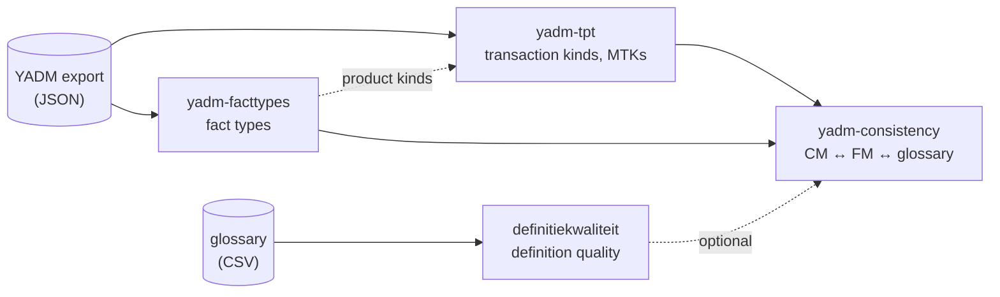

# kern-skills
KERN: Kennis, Essentie, Regels, Naamgeving

English: Knowledge, Essence, Rules, Notions

This repository is work-in-progress and contains skill files to:
- build an (enterprise) ontology (transactions, processes, facts, rules, term and definitions) from input text
- validate an (enterprise) ontology against some pre-defined quality criteria and check its internal consistency

These skills follow the open Agent Skills standard, so they work in both Claude Code and Google Antigravity without any changes.

Licensed under the MIT License. See LICENSE for details.

## Skills

| Skill | Description | Documentation |
|---|---|---|
| [`definitiekwaliteit`](skills/definitiekwaliteit) | Checks a glossary (terms, definitions, references, examples) against the ASTRA rules for definition quality plus additional KERN rules, and proposes improved definitions, references, examples and missing terms. Includes a reference graph of the definitions to find cycles and undefined terms. In Dutch. | [docs/definitiekwaliteit.md](docs/definitiekwaliteit.md) |
| [`yadm-tpt`](skills/yadm-tpt) | Extracts transaction kinds (with type O/I/D), executing actor roles, initiator links, information links and multiple transaction kinds (MTKs) from a YADM export (DEMO model, JSON), and lists them as a transaction table and an MTK table. Adds the product kind of each transaction kind when the fact model exports are passed too. In Dutch. | [docs/yadm-tpt.md](docs/yadm-tpt.md) |
| [`yadm-facttypes`](skills/yadm-facttypes) | Extracts all fact types (entity types, attribute types with value type, property types and product kinds) from one or more YADM exports (DEMO fact model, JSON), merges them across exports, and lists them in one table with derivations (specialisation, generalisation, aggregation), ordered from elementary to derived. In Dutch. | [docs/yadm-facttypes.md](docs/yadm-facttypes.md) |
| [`yadm-consistency`](skills/yadm-consistency) | Checks the consistency between the cooperation model (CSD) and the fact model in YADM exports: transaction kinds against product kinds, variables in formulations, cardinalities, value types, internal and external entity types, naming across diagrams. Optionally checks the fact model against a glossary, including content (specialisations, generalisations and aggregations against genus and definitions), and against a bank contact table (which facts sit in which bank). Builds on the three skills above. In Dutch. | [docs/yadm-consistency.md](docs/yadm-consistency.md) |

Detailed documentation per skill is in the [`docs`](docs) folder.

### Rule identifiers

Skills that check against rules keep them in a CSV file in the skill's `references` folder. KERN rule IDs are unique across skills: `KERN-<skill letter>-<category><number>`.

| Prefix | Skill | Example |
|---|---|---|
| `KERN-D-` | [`definitiekwaliteit`](docs/definitiekwaliteit.md) (definitions) | `KERN-D-ESS04`: time dependency via a `[dag]` variable |
| `KERN-C-` | [`yadm-consistency`](docs/yadm-consistency.md) (consistency) | `KERN-C-TK01`: every original transaction kind has a product kind |

Rules taken from an external source keep their own IDs, such as the ASTRA rules (`CON-01`, `ESS-05`) in `definitiekwaliteit`.

### How the skills fit together

Skills reuse each other's scripts instead of duplicating them. `yadm-consistency` needs the other three in the same skills folder; `yadm-tpt` uses `yadm-facttypes` for the product kinds when it is there.



## Quick start
 
You can either manually download the required skill files or simply clone this repo:
 
```bash
git clone https://github.com/mkrouwel/kern-skills.git
cd kern-skills
```
 
Then copy the skill folders into the location for your tool (see below). You can install all skills or just the ones you need.
 
### Using with Claude Code
 
Works with the Claude Code CLI, the VS Code and JetBrains extensions, and the Claude desktop app. All of them read skills from the same folders.
 
**Personal install (available in all your projects):**
 
```bash
mkdir -p ~/.claude/skills
cp -r skills/* ~/.claude/skills/
```
 
**Project install (available only in one project, shared with anyone who clones it):**
 
```bash
mkdir -p /path/to/your-project/.claude/skills
cp -r skills/* /path/to/your-project/.claude/skills/
```
 
Claude Code picks up new skills automatically. If the `skills` folder didn't exist before you started your session, restart Claude Code once.
 
Docs: https://code.claude.com/docs/en/skills
 
### Using with Google Antigravity
 
**Project install (IDE and CLI):**
 
```bash
mkdir -p /path/to/your-project/.agents/skills
cp -r skills/* /path/to/your-project/.agents/skills/
```
 
**Global install, Antigravity IDE:**
 
```bash
mkdir -p ~/.gemini/config/skills
cp -r skills/* ~/.gemini/config/skills/
```
 
**Global install, Antigravity CLI (`agy`):**
 
```bash
mkdir -p ~/.gemini/antigravity-cli/skills
cp -r skills/* ~/.gemini/antigravity-cli/skills/
```
 
In the IDE, you can confirm the skills are loaded under the **Customizations** menu in the agent side panel.
 
Docs: https://antigravity.google/docs/skills
 
## How to use the skills
 
Just describe your task normally. The agent reads each skill's description and automatically loads the relevant one when it fits your request.
 
In Claude Code you can also call a skill directly by typing `/skill-name`.
